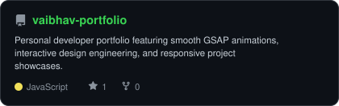
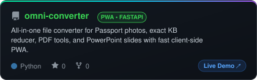
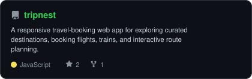
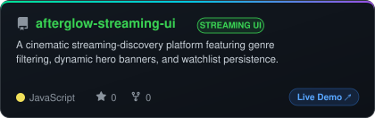

<h1 align="center">Hi, I'm Vaibhav Tevatia 👋</h1>

<p align="center">

</p>

<p align="center">
<a href="https://www.linkedin.com/in/vaibhav-tevatia-a1788842a/"></a>
<a href="mailto:vaibhavtevatia7946@gmail.com"></a>
<a href="https://vaibhav-portfolio-rho.vercel.app/"></a>
<a href="https://leetcode.com/u/00JxtSQG7B/"></a>
</p>

<p align="center">

</p>

---

<h2 align="center"><code>~/</code> who I am</h2>

```js
const vaibhavTevatia = {
  title: "CSE Student | Aspiring Software Developer",
  stack: {
    languages: ["C++", "C", "Python", "JavaScript", "Go"],
    web: ["HTML", "CSS", "JavaScript"],
    strengths: ["Data Structures & Algorithms", "Problem Solving"],
  },
  currentlyExploring: "Backend systems with Golang",
  funFact: "Believes clean code and clean algorithms go hand in hand"
};
```

---

<h2 align="center"><code>~/</code> toolbox</h2>

<p align="center">

</p>

---

<h2 align="center"><code>~/</code> skill radar</h2>

<p align="center">

</p>

---

<h2 align="center"><code>~/</code> github stats</h2>

<p align="center">


</p>

<p align="center">

</p>

---

<h2 align="center"><code>~/</code> contribution calendar</h2>

<p align="center">

</p>

<p align="center">

</p>

---

<h2 align="center"><code>~/</code> contribution activity graph</h2>

<p align="center">
  <a href="https://github.com/vaibhavtevatia7946">
    <picture>
      <source media="(prefers-color-scheme: dark)" srcset="https://github-readme-activity-graph.vercel.app/graph?username=vaibhavtevatia7946&theme=tokyo-night&area=true&hide_border=true&custom_title=Contribution%20Activity%20Graph">
      <source media="(prefers-color-scheme: light)" srcset="https://github-readme-activity-graph.vercel.app/graph?username=vaibhavtevatia7946&theme=tokyo-day&area=true&hide_border=true&custom_title=Contribution%20Activity%20Graph">
      
    </picture>
  </a>
</p>

---

<h2 align="center"><code>~/</code> activity trail</h2>

<p align="center">

</p>

---

<div align="center">

## `~/` selected work
<sub>✨ Featured builds, full-stack applications & creative design engineering</sub>

<br>

<table>
<tr>
<td width="50%">
  <a href="https://vaibhav-portfolio-rho.vercel.app/">
    <picture>
      <source media="(prefers-color-scheme: dark)"  srcset="assets/card-vaibhav-portfolio-dark.svg">
      <source media="(prefers-color-scheme: light)" srcset="assets/card-vaibhav-portfolio-light.svg">
      
    </picture>
  </a>
</td>
<td width="50%">
  <a href="https://github.com/vaibhavtevatia7946/omni-converter">
    <picture>
      <source media="(prefers-color-scheme: dark)"  srcset="assets/card-omni-converter-dark.svg">
      <source media="(prefers-color-scheme: light)" srcset="assets/card-omni-converter-light.svg">
      
    </picture>
  </a>
</td>
</tr>
<tr>
<td width="50%">
  <a href="https://github.com/vaibhavtevatia7946/tripnest">
    <picture>
      <source media="(prefers-color-scheme: dark)"  srcset="assets/card-tripnest-dark.svg">
      <source media="(prefers-color-scheme: light)" srcset="assets/card-tripnest-light.svg">
      
    </picture>
  </a>
</td>
<td width="50%">
  <a href="https://github.com/vaibhavtevatia7946/afterglow-streaming-ui">
    <picture>
      <source media="(prefers-color-scheme: dark)"  srcset="assets/card-afterglow-streaming-ui-dark.svg">
      <source media="(prefers-color-scheme: light)" srcset="assets/card-afterglow-streaming-ui-light.svg">
      
    </picture>
  </a>
</td>
</tr>
</table>

<sub>

| project | live | stack |
|---|---|---|
| **[vaibhav-portfolio](https://vaibhav-portfolio-rho.vercel.app/)** | [vaibhav-portfolio-rho.vercel.app ↗](https://vaibhav-portfolio-rho.vercel.app/) | `JavaScript` `GSAP` `HTML5` |
| **[omni-converter](https://github.com/vaibhavtevatia7946/omni-converter)** | [omni-converter-web.vercel.app ↗](https://omni-converter-web.vercel.app) | `Python` `FastAPI` `PWA` |
| **[tripnest](https://github.com/vaibhavtevatia7946/tripnest)** | [tripnest-redesign.vercel.app ↗](https://tripnest-redesign.vercel.app/) | `HTML5` `CSS3` `JavaScript` |
| **[afterglow](https://github.com/vaibhavtevatia7946/afterglow-streaming-ui)** | [afterglow-streaming-ui.app ↗](https://vaibhavtevatia7946.github.io/afterglow-streaming-ui/) | `JavaScript` `CSS3` `UI/UX` |

</sub>

</div>

---

<p align="center">
  
</p>

---

<h2 align="center"><code>~/</code> connect with me</h2>

<p align="center">
<a href="https://www.linkedin.com/in/vaibhav-tevatia-a1788842a/"></a>
<a href="mailto:vaibhavtevatia7946@gmail.com"></a>
</p>

<p align="center"><i>Thanks for visiting — always open to collaborating on interesting projects! 🚀</i></p>
